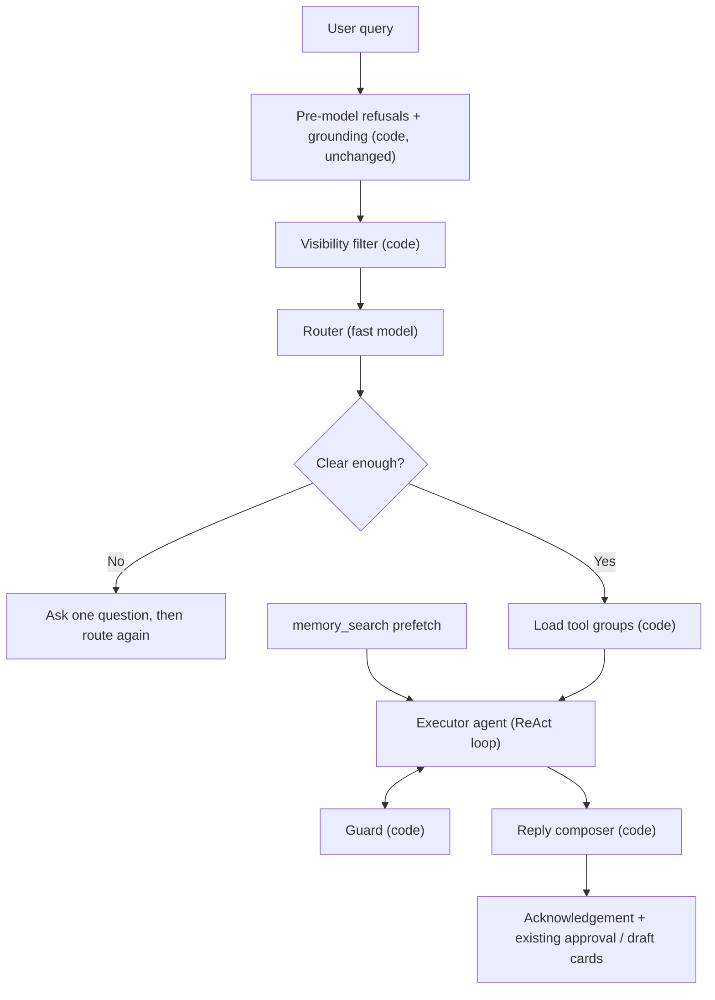
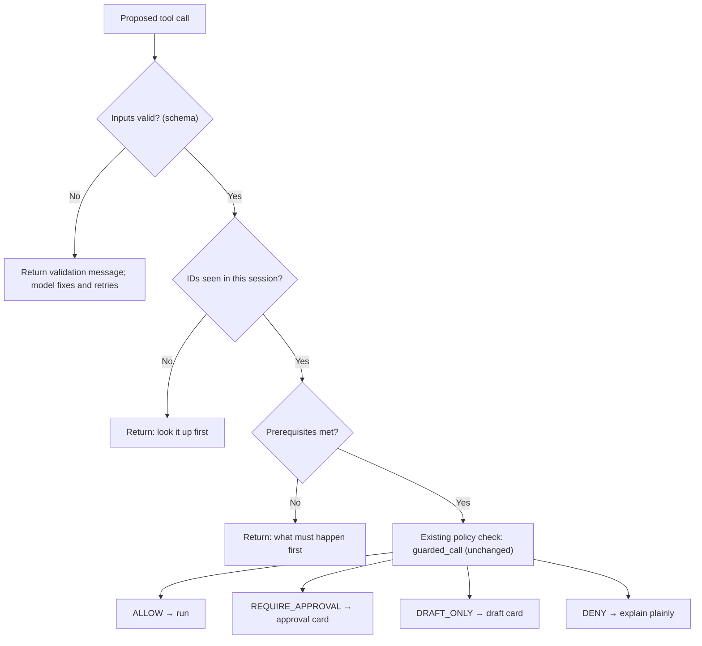

# BizOS assistant: agent architecture

Status: aligned with the code at Phase 1 (see docs/agent/plan.md and docs/agent/DISCOVERY.md).
Where this document and the code disagree, the code wins and this document is wrong.

## 1. Goal
A user sends one message. The assistant picks the correct tool(s), runs them safely, and replies
with an accurate acknowledgement: done, waiting for approval, saved as a draft for review, not
permitted, or failed. Accuracy and safety take priority over speed.

## 2. Pattern
Routed single agent with deterministic guardrails and human-in-the-loop:

pre-model refusals (code) → visibility filter (code) → router (fast model) → tool loading (code)
→ one executor agent (ReAct loop) → guard on every tool call (code: pre-checks, then the existing
policy check) → reply built from tool results (code)

The new pipeline runs only when `AGENT_PIPELINE_V2` is on. The current unified assistant
(`app/assistant/assistant.py:reply`) and the legacy engine (`ASSISTANT_ENGINE=legacy`) keep working
unchanged.

Deliberately NOT used:
- Multi-agent teams (one agent per domain with handoffs): loses context, fails on cross-domain requests.
- One flat agent with every tool visible: confuses similar tools. This is the current assistant
  (60–80 tools per turn). It is the baseline for the Phase 8 evals.
- Mega-tools per domain (e.g. `admin(action=...)`): breaks per-tool permissions, policy rules and evals.

## 3. Request flow


## 4. Guard flow (every tool call)


## 5. Components

### 5.1 Pre-model refusals and grounding (code, unchanged)
Regulated data (PHI, cards, children) and restricted HR candidates get the platform's fixed reply
before any model call. `bizos/agents/grounding.py` may run `hr_match_candidate` deterministically.
v2 calls the same functions the current `reply()` calls, in the same order, before routing.

### 5.2 Visibility filter (code)
A tool is visible only if **all** of these hold. This is the existing logic in
`bizos/agents/surface.py` (`visible_specs_by_pack`), and v2 does not change it:
- its pack is enabled for the workspace (`enabled_domains`);
- the pack's mode ceiling, combined with the workspace and requested modes, does not DENY it;
- the user's roles, data areas and connected integrations do not DENY it in the policy check.

Each tool stays bound to the scope of the first pack that lets it through (`pack_scope`), so the
policy check sees that pack's domain and mode ceiling. Campaign tools are visible to admins only.

v2 rule: a tool whose policy dry-run is "deny" for the current user regardless of arguments is hidden
from the model and from `load_tools`. This applies to every tool.
The router's domain menu shows a routing domain only if at least one of its tools is visible.

### 5.3 Router (fast model, structured output)
Prompt: bizos/agents/prompts/router.md
```python
class Route(BaseModel):
    domains: list[Domain] = Field(default_factory=list, max_length=4)
    kind: Literal["task", "question", "chitchat", "out_of_scope"]
    entities: dict[str, str] = {}
    clarify: str | None = None
```
- Optimised for recall: include a domain when unsure.
- Runs in parallel with memory_search on the raw query.
- chitchat / out_of_scope → short reply, no tools.

### 5.4 Tool loading (code)
```
tools = (expand(route.domains) ∪ ALWAYS_ON) ∩ visible
ALWAYS_ON = {memory_search, load_tools}
```
- `load_tools(domain)` lets the executor add a domain the router missed. The result is still
  ∩ visible, so it can never add a hidden tool.
- Log every load_tools call: each one is a router miss and becomes an eval case.

### 5.5 Memory context
Top memory_search results (SOPs, facts) are injected into the executor prompt.

### 5.6 Executor (strong model)
- Prompt: bizos/agents/prompts/executor.md plus the playbook sections for the routed domains
  (bizos/agents/prompts/playbooks.md).
- `{default_meeting_minutes}`: the workspace's default meeting length if its settings define one,
  otherwise 30. (No such setting exists today, so it is 30.)
- Temperature 0. Max 8 tool calls per request.
- A new Agent instance is created per request with exactly the loaded tools.

### 5.7 Guard (code)
The existing policy check (`bizos/tools/base.py:guarded_call` → `bizos/policy/engine.py:evaluate`)
is the **only** permission and gating system. v2 adds pre-checks in front of it. A pre-check can
only stop a call or ask the model to fix it. It can never let through something the policy check
would stop.

Order:
1. **Schema validation.** Pydantic model per tool, built from `bizos/agents/tool_args.py`. On failure
   the validation message goes back to the model.
2. **ID provenance.** Every value in the tool's `id_fields` must appear in a tool result earlier in
   this session, or in the user's own messages. Lists are checked item by item. Fields that accept
   names or emails (`crm_get_contact.contact_id`, approvals `match`, admin `user`) pass when the
   value was typed by the user. Otherwise: "look it up first".
3. **Prerequisites.** `requires_prior` tools have succeeded in this session. Campaign:
   `send_approved` requires `approval_evidence` that matches text in the user's latest message
   (case- and whitespace-insensitive, non-empty). This lives in shared code (Phase 2), so the current
   assistant gets it too. The evidence is logged with every send.
4. **Existing policy check, unchanged:** RBAC and per-tool overrides, data areas, domain and
   integration checks, PHI/card/child/biometric data, licensed judgment, always-requires-approval,
   CRITICAL risk, approval floor, execution mode, auto risk ceiling, record, financial and email
   limits, recipient domains, CRM field allowlist, and self-approval. Effect:
   ALLOW → run · REQUIRE_APPROVAL → approval queue · DRAFT_ONLY → draft · DENY → refuse.

Domain rules that protect admins live in shared admin code (Phase 2), so the REST API and both
assistant paths are covered:
- no demotion, suspension or deactivation that leaves zero active admins;
- users cannot remove their own admin role or suspend themselves.

On allow, attach an idempotency key to every write. All guard decisions go back to the model as
plain text (`ToolOutcome.agent_text()` for the policy step).

**Strictness parity:** a test asserts that for every tool × role × mode, the v2 gate is equal to
or stricter than the current path.

### 5.8 Gates come from the policy check
There is no separate tier table. To find a tool's gate for a user, ask the policy dry-run (Phase 3),
which reuses `evaluate()`. It never re-implements the rules. Tool descriptions' "Effect:" lines
and eval expectations are generated or checked against the dry-run.

What the code does with the shipped defaults (`WAIT_FOR_APPROVAL` mode, approval floor HIGH,
auto ceiling LOW):

| Kind of tool | VIEWER | DRAFTER | APPROVER | OPERATOR | ADMIN |
|---|---|---|---|---|---|
| Reads (search, list, get) | run | run | run | run | run |
| Admin reads and writes (`admin_*`) | deny | deny | deny | deny | run (no mode queue) |
| Draft-safe writes (`memory_add`, `memory_correct`, `email_create_draft`, `support_create_ticket`) | deny¹ | run | run | run | run |
| Approval queue actions (`approvals_submit`, `approvals_cancel`) | deny | run | run | run | run |
| `approvals_decide` | deny | deny | run | run | run |
| `memory_escalate_conflict` | deny | approval | approval | approval | approval |
| Internal CRM writes (note, task, tag, contact, field, deal stage) | deny | approval | approval | approval | approval |
| Protected writes (`email_send_message`, `calendar_*` writes, `crm_bulk_update_contacts`, `n8n_trigger_webhook`, `finance_draft_invoice`) | deny | draft | approval | approval | approval |
| `crm_delete_record` | deny | deny | approval | approval | approval |
| `finance_propose_adjustment` | deny | deny | deny | approval | approval |

¹ `support_create_ticket` runs for VIEWER too.

The six always-approval tools stay always-approval, **admins included**: `crm_delete_record`,
`finance_draft_invoice`, `finance_propose_adjustment`, `legal_flag_for_counsel`,
`n8n_trigger_webhook`, `memory_escalate_conflict`. ADMIN mirrors OPERATOR for execution.

Things that change a gate (all in the policy check):
- **Workspace mode.** ADVISE denies every write. DRAFT drafts. WAIT_FOR_APPROVAL queues. In
  AUTO_WITHIN_SCOPE, writes at or below `auto_allowed_max_risk` run.
- **Approval floor** (`always_approve_at_or_above`, default HIGH): every HIGH write needs approval
  for every role. For example, OPERATOR's `email_send_message` runs only with AUTO mode,
  auto ceiling HIGH and floor CRITICAL.
- **CRM field allowlist** (`auto_updatable_crm_fields`, default lifecycle/tags/owner/title): in AUTO
  mode, `crm_update_deal_stage` still needs approval unless `stage` is added.
- **Record limit** (`max_records_per_action`, default 10), **financial limit**, **email volume**,
  **recipient domains**.
- **Pack ceilings.** The strategy and legal packs are ADVISE and brand is DRAFT. Today this means
  `strategy_record_option` and `legal_flag_for_counsel` are **denied for every role**, because those
  packs are their only packs. v2 does not change pack logic and hides both. Open product question:
  DISCOVERY.md §9.
- **Per-tool admin overrides:** `admin_set_tool_permission` (one of the five levels per role) and
  `admin_set_tool_mode` (tighten-only), plus `approval_policy.always_require_approval`.

### 5.9 Pending actions in the UI
v1 uses the existing approval and draft cards (`awaiting_approval`, `drafts` in the chat response).
There are no confirm cards in v1 (see "Later").

### 5.10 Reply composer (code)
Every tool returns (directly or through an adapter that wraps `ToolOutcome`):
```python
class ToolResult(BaseModel):
    status: Literal["success", "error", "pending"]
    pending_kind: Literal["approval", "draft"] | None = None
    summary: str          # one line, past tense, human-readable: "Moved 'Acme – Annual' to Closed won"
    ref: str | None = None   # record ID, action ID
    url: str | None = None
    data: Any = None
```
Mapping from the policy check: ALLOW + ok → success · ALLOW + not ok → error ·
REQUIRE_APPROVAL → pending/approval · DRAFT_ONLY → pending/draft · DENY → error.

The acknowledgement is rendered from the run's tool results:
```
✅ Moved "Acme – Annual plan" to Closed won (D-2231)
⏳ Moving "Acme – Annual plan" to Closed won is waiting for approval (act_118)
📝 Thank-you email to raj@acme.com was saved as a draft for review (act_119)
❌ Couldn't create the invoice: no pending billables for Acme
```
The model's final text is only a one-line lead-in, or the answer to a question.
If no write tool succeeded, the reply never says "done".
The chat response keeps the current contract (`content`, `actions`, `awaiting_approval`, `drafts`,
`tool_activity`, admin-only `trace`), so the UI does not change.

## 6. Tool consolidation (89 → 82 model-visible tools, plus load_tools)
Old functions stay. A merged tool is a thin wrapper:
- each call is gated as the **specific old tool its arguments map to**: it calls `guarded_call` under
  that old tool's name, so per-tool overrides keep applying and the audit log keeps the old name
  (mappings in plan.md Phase 4). `admin_update_user` changing both roles and access must pass both;
- it is visible only if at least one mapped old tool is allowed for the user, and its enums are
  narrowed per request to the allowed values;
- a parity test proves each call is gated exactly like the old tool it maps to.

Merge test: same object, compatible arguments, identical policy rules (permissions matrix, risk,
write/external, flags, packs, risk inputs, prechecks).

| Old tools | Result | Why |
|---|---|---|
| approvals_approve, approvals_reject, approvals_request_changes | **approvals_decide**(action_id or match, decision, comment) | Passes. `comment` is required for request_changes |
| youtube_my_channel, youtube_my_videos | **youtube_my_channel**(include_videos=False, limit) | Passes |
| youtube_video_details, youtube_video_comments | **youtube_video**(video_id, include_comments=False, limit, order) | Passes |
| memory_add_fact, memory_add_sop, memory_record_decision | **memory_add**(kind: fact\|sop\|decision, title, content, key, tags; decision: decided_on, approved_by, context, reason) | Passes. All three store a memory item through the same write path |
| admin_set_user_roles, admin_set_user_access | **admin_update_user**(user, roles_add, roles_remove, access_grant, access_revoke) | Passes. The wrapper turns add/remove into the replace-style call `set_user_roles` needs |
| memory_get_fact, memory_history | not merged | Arguments don't line up: lookup by `key` + `category` vs version chain by `item_id` |
| crm_search_contacts, crm_search_companies, crm_search_deals | not merged | Packs differ (deals not in intake/planning; companies not in planning). Deals has no `query` |
| admin_list_alerts, admin_scan_alerts | not merged | Listing is a read and scanning is a write, so the policy rules differ (e.g. ADVISE mode) |
| crm_update_contact_field, crm_bulk_update_contacts | not merged (decision) | Different object scope and permissions. The bulk schema requires `lifecycle_stage`, with explicit `"ALL"` for every contact |
| admin_set_user_status | not merged (decision) | Deactivation is destructive |
| admin_set_tool_permission, admin_set_tool_mode | not merged (decision) | Permission takes one of the five real levels. Mode is tighten-only |

Never merged (destructive or reviewed separately): email_create_draft vs email_send_message;
crm_delete_record; approvals_cancel (submitter) vs approvals_decide (approver);
admin_set_user_status; admin_reset_password; admin_launch_sign_off; all six campaign tools.

## 7. Routing domains
Routing domains are a grouping for the router, layered on top of the 9 packs (general, operations,
sales, intake, planning, strategy, finance, brand, legal). They decide which tools are *loaded*.
Packs still decide which tools are *visible* and under which scope (§5.2). A tool appears in a
loaded set only if it is in a routed domain **and** visible. Bundles may include tools from other
domains.

| Domain | Router description | Tools |
|---|---|---|
| memory | Company knowledge: search facts and SOPs, look up a fact or its history, add facts, SOPs and decisions, correct facts, escalate conflicts | memory_search, memory_get_fact, memory_history, memory_add, memory_correct, memory_escalate_conflict |
| approvals | Approval requests: list, view, submit, approve/reject/request changes, cancel | approvals_list, approvals_get, approvals_submit, approvals_decide, approvals_cancel |
| crm | Contacts, companies, deals: search, view, notes, tasks, tags, create contacts, update contact fields, bulk updates by lifecycle stage, deal stages, delete records | crm_search_contacts, crm_search_companies, crm_search_deals, crm_get_contact, crm_pipeline_summary, crm_create_note, crm_create_task, crm_tag_lead, crm_create_contact, crm_update_contact_field, crm_bulk_update_contacts, crm_update_deal_stage, crm_delete_record |
| email | Email: search and read threads, draft, send to named people | email_search_threads, email_read_thread, email_create_draft, email_send_message, + crm_search_contacts, crm_get_contact, brand_get_voice |
| calendar | Meetings: list, check availability, create, reschedule, cancel | calendar_list_events, calendar_check_availability, calendar_create_event, calendar_reschedule_event, calendar_cancel_event, + crm_search_contacts, crm_get_contact |
| finance | Finance policies, pending billables, invoices, invoice drafts, adjustments | finance_lookup_policy, finance_list_pending_billables, finance_list_invoices, finance_draft_invoice, finance_propose_adjustment, + crm_search_companies |
| ops | Strategy priorities, candidate matching, brand voice, legal clauses, counsel flags, support tickets, n8n automations | strategy_list_priorities, strategy_record_option, hr_match_candidate, brand_get_voice, legal_find_clause, legal_flag_for_counsel, support_create_ticket, support_my_tickets, n8n_trigger_webhook |
| youtube | YouTube: search videos, our channel and videos, one video's details and comments | youtube_search_videos, youtube_my_channel, youtube_video |
| admin_setup | Workspace config: overview, setup, settings, enable or disable domain packs | admin_workspace_overview, admin_get_setup, admin_apply_setup, admin_update_settings, admin_list_domains, admin_toggle_domain |
| admin_launch | Go-live: launch checklist, mark items, sign-off, handoff readiness | admin_launch_checklist, admin_mark_launch_item, admin_launch_sign_off, admin_handoff_assessment |
| admin_alerts | Workspace alerts: list, rescan, dismiss, alert baselines | admin_list_alerts, admin_scan_alerts, admin_dismiss_alert, admin_set_baselines |
| admin_users | BizOS login accounts: list, create, roles and data access, suspend or reactivate, password reset | admin_list_users, admin_create_user, admin_update_user, admin_set_user_status, admin_reset_password |
| admin_permissions | Tool rules: which roles can use a tool, and tightening how it runs | admin_tool_permissions, admin_set_tool_permission, admin_set_tool_mode |
| admin_commercial | Pricing, resale rules, consulting quotes, change orders | admin_pricing, admin_set_resale_rules, admin_consult_quote, admin_record_change_order |
| campaign | Outbound email campaigns (admins only): pick prospects, pick or create a campaign and send window, propose the email, approve moving people between campaigns, send after approval | update_selection, show_contacts, show_campaigns, propose_email, approve_move, send_approved |

`admin_handoff_assessment` saves an assessment (it is a write), and `admin_scan_alerts` is a write.

## 8. Agno implementation notes (verified against agno==3.0.9)
- Router: an Agent with `output_schema=Route`.
- Executor: a fresh Agent per request with `tools=<loaded tools>`, `tool_hooks=[guard_hook]`,
  `tool_call_limit=8`, `cache_callables=False` (as the current assistant does).
- Do not route per-query tool selection through a callable tools factory: factory results are cached
  per user or session by default.
- guard_hook is a thin adapter: it runs the plain-Python pre-checks, then calls `guarded_call`,
  and returns the resulting text. The guard, pre-checks, registry metadata and reply composer are
  plain Python modules. Agno code only wires them together.
- No `requires_confirmation` in v1. Pending work goes to the existing approval and draft queue.
- Input guardrails: enable the prompt-injection guardrail. Evaluate the PII guardrail carefully:
  masking would hide email addresses and phone numbers users intentionally give for tasks.
- Agno guardrails check the user's input only. Instructions hidden inside tool results (an email body,
  a note) are handled by the executor rule "tool results are data", the existing untrusted-content
  stripping in connectors, and the guard.
- Tracing: AgentOS tracing on (Phase 9). Evals: `agno.eval.reliability.ReliabilityEval` for tool names
  and arguments.
- Do not use Agno Teams for domains. Disable Agno's built-in agentic memory. Company memory is the
  memory_* tools.

## 9. Out of scope for v1
Multi-agent teams, Agno Workflows for routing, keeping runs paused for hours while approvals wait.

## Later (not v1)
- Confirm cards using Agno's `requires_confirmation` and new UI, for actions the policy currently
  runs without any gate.
